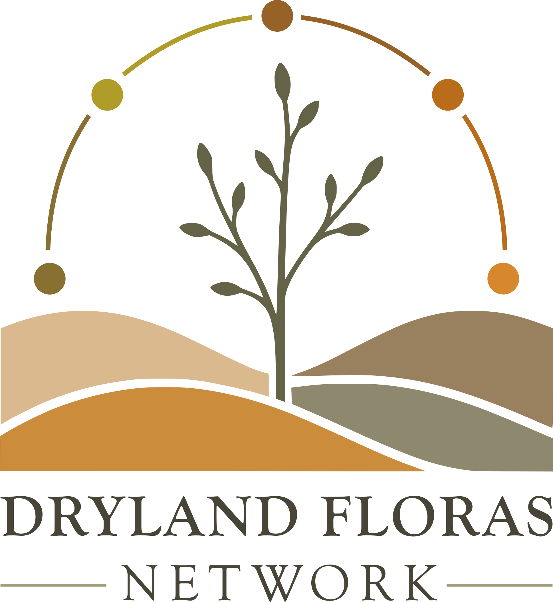

<!-- README.md is generated from README.Rmd. Please edit that file -->

# Dryland Floras Network 

The Dryland Floras Network connects botanists, ecologists and other researchers dedicated to understanding and conserving plant diversity across drylands worldwide.

## Website status

The website is currently being reorganized around the Dryland Floras Network.

- Updates: Under construction.
- Join: Under construction.
- Network counter (affiliated scientists and countries): Under construction.
