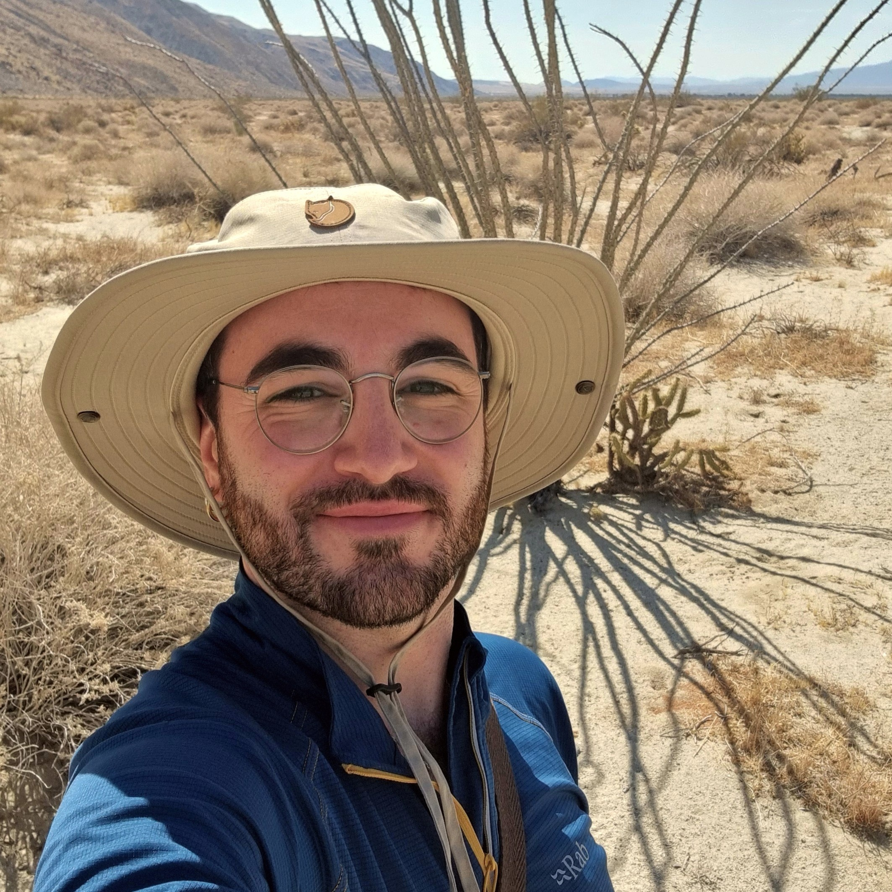
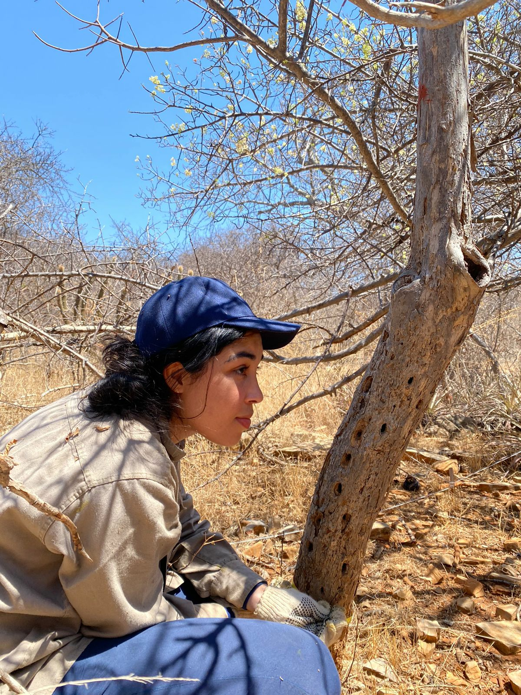
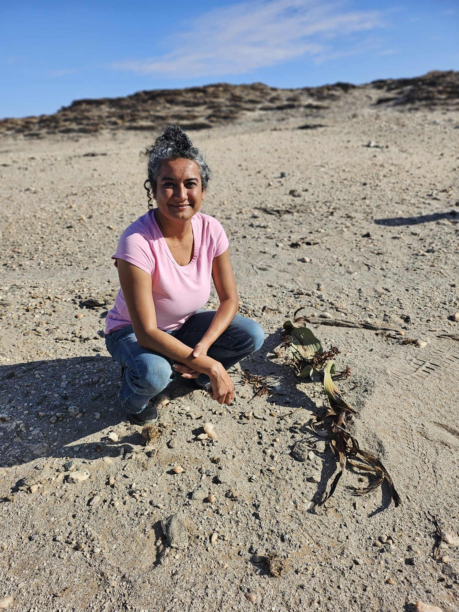

# Team

This page presents the researchers, institutions and collaborators participating in the Dryland Floras Network. Please reach out via email to sign up!

::: {.member-card}

::: {.member-info}

## Marc Fradera-Soler

::: {.member-photo}

:::

Postdoctoral researcher at Stockholm University (Sweden). Botanist working on plant diversity and evolution, with a strong focus on deserts and succulent floras. Previous work includes evolution of genus *Crassula* (Crassulaceae) in southern Africa, and macroevolutionary patterns of drought–frost resistance in plant groups occurring in hot and cold deserts worldwide.

**Email:** marc.fradera-soler@su.se

[Google Scholar](https://scholar.google.com/citations?user=AXh6wmgAAAAJ&hl=ca)  
[ResearchGate](https://www.researchgate.net/profile/Marc-Fradera-Soler)  
[ORCID](https://orcid.org/0000-0002-4270-508X)

:::

:::

::: {.member-card}

::: {.member-info}

## Débora Zuanny

::: {.member-photo}

:::

PhD candidate at the University of Edinburgh and the Royal Botanic Garden Edinburgh, interested in understanding large-scale patterns of plant diversity, distribution, and evolution. My previous research focused on the Caatinga, a seasonally dry tropical forest domain in Brazil.

**Email:** deborazuanny@gmail.com

[ORCID profile](https://orcid.org/0000-0001-6623-3788)  
[Google Scholar](https://scholar.google.com/citations?hl=pt-BR&user=mYGCrlEAAAAJ)  
[GitHub](https://github.com/deborazuanny)

:::

:::

::: {.member-card}

::: {.member-info}

## Bharti Parihar

::: {.member-photo}

:::

PhD student at the University of Florida (U.S.) whose research integrates plant systematics, genomics, developmental biology, and ecophysiology to understand the evolution of specialized traits in succulent and dryland plants. My work spans scales from gene expression and developmental morphology to genome evolution, phylogenomics, photosynthetic physiology, and macroevolutionary trait reconstruction.

**Email:** bharti.parihar@ufl.edu

[Google Scholar](https://scholar.google.com/citations?user=my2gb8cAAAAJ&hl=en)  
[ORCID](https://orcid.org/0000-0002-9863-4620)

:::

:::

